# AETHER

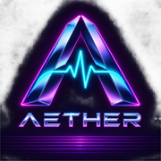

**Eine Windows-Kommandozentrale für den eigenen Rechner.**

Meine Ausgangsfrage war ziemlich einfach:

Warum brauche ich unter Windows so viele unterschiedliche Programme und
Verwaltungsoberflächen, um zu verstehen, was auf meinem eigenen Rechner
passiert?

Task-Manager, Geräte-Manager, Ereignisanzeige, Dienste, Aufgabenplanung,
Systeminformationen, PowerShell, Herstellerprogramme und verschiedene
Hardwarewerkzeuge zeigen jeweils nur einen Teil des Ganzen.

AETHER ist mein Versuch, daraus ein zusammenhängendes Cockpit zu machen.
Nicht jedes vorhandene Windows-Werkzeug ersetzen, sondern einen
gemeinsamen Ausgangspunkt schaffen.

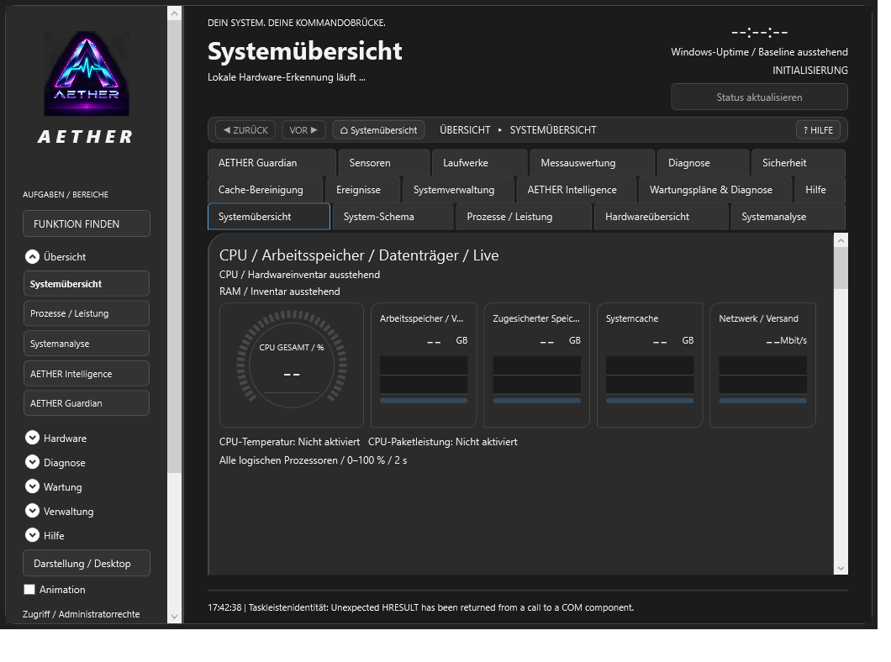

*AETHER Cockpit mit Navigation, Hardwarezustand und Verwaltungsbereichen.
Die Aufnahme stammt aus dem Beta-54-Prüfstand.*

## Wie AETHER entstanden ist

AETHER begann als Idee für ein Hardware- und Windows-Systemcockpit. Ich
wollte aktuelle Hardware sehen, Temperaturen und Last verstehen, Prozesse
einordnen, Windows-Zustände erkennen und Diagnose nicht über zehn
Programme verteilen.

Aus der Idee wurde mit der Zeit deutlich mehr. Nicht, weil von Anfang an
ein großer Masterplan existierte, sondern weil sich bei jeder neuen
Funktion dieselbe Frage stellte:

**Warum liegt diese Information eigentlich wieder in einem anderen
Windows-Werkzeug?**

AETHER ist an dieser Frage gewachsen.

## Warum AETHER so aussieht

Meine Vorstellung davon, wie ein Computer aussehen und funktionieren
sollte, ist nicht in den letzten Jahren entstanden. Sie kommt aus den 80ern
und 90ern.

Ich bin mit dieser PC-Welt groß geworden. 386er, DOS, Windows 3.x,
Windows 95, Bootdisketten, Steckkarten, Jumper, Treiber, Kabel, Aufrüsten,
Fehler suchen und Systeme neu aufsetzen gehörten dazu. Wenn etwas nicht
funktionierte, konnte man selten einfach auf einen Knopf drücken. Man
musste verstehen, was der Rechner macht.

Genau das hat mich geprägt. Ich will bis heute nicht nur wissen, dass
etwas funktioniert. Ich will verstehen, warum.

Gleichzeitig zeigten Filme, Spiele und Computerzeitschriften damals eine
bestimmte Vorstellung vom Computer der Zukunft: dunkle Kommandozentralen,
leuchtende Anzeigen, technische Instrumente, Raster, Statusanzeigen und
Systeme, die ihren eigenen Zustand sichtbar machen.

Das Retro-Neon-Design, das Mainboard und die Instrumente sind deshalb
keine nachträglich aufgesetzte Dekoration. Sie verbinden die Computerwelt,
mit der für mich alles angefangen hat, mit der Zukunft, die ich mir damals
vorgestellt habe.

**Im Grunde baue ich mit AETHER ein Stück der PC-Zukunft, die ich mir in
den 90ern gewünscht hätte.**

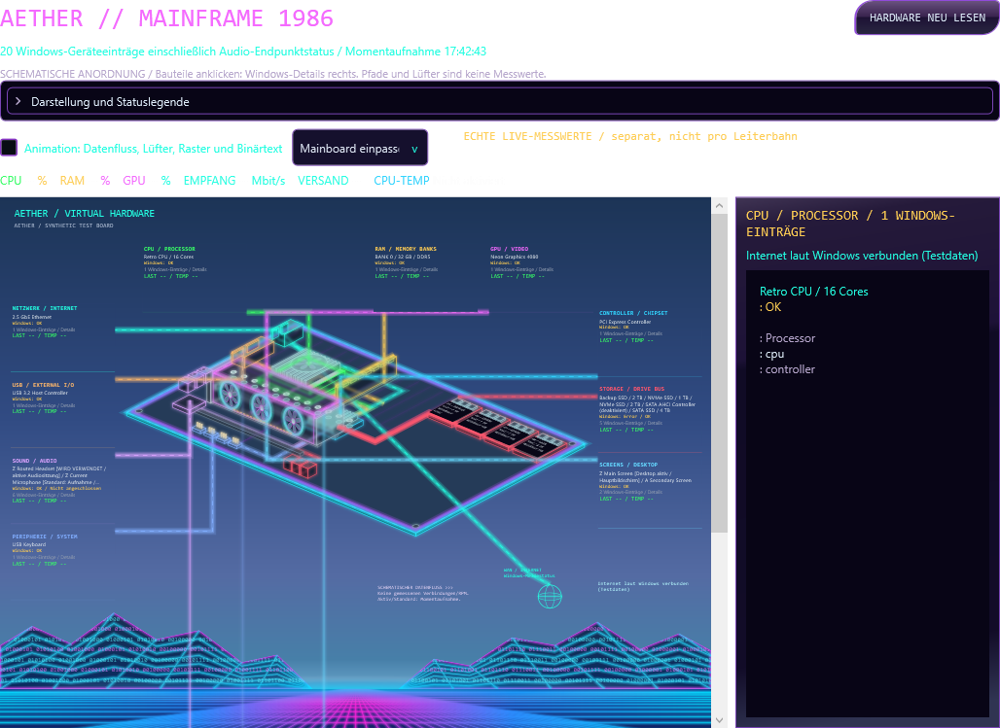

*AETHER-Mainboard mit synthetischen Testdaten zur Darstellung der
Hardwareoberfläche.*

## Was AETHER heute ist

AETHER ist inzwischen deutlich mehr als ein Hardwaremonitor. Die
vorhandenen Bereiche bringen Informationen aus Windows und der Hardware
in einer gemeinsamen Oberfläche zusammen.

### System und Hardware

- Systemübersicht mit verfügbaren CPU-, RAM-, GPU-, Datenträger- und
  Netzwerkwerten
- Mainboard- und Hardwareansichten
- CPU, GPU, Speicher, Datenträger und vorhandene Sensoren
- Prozesse und ausgewählte Leistungszusammenhänge
- SMART- und NVMe-Befunde, soweit vom System verfügbar

Nicht jede Hardware liefert dieselben Daten. Fehlende Sensoren bleiben
nicht verfügbar; Herstellergrenzen und Temperaturgrenzen sind keine
Messwerte.

### Windows-Diagnose und Verwaltung

- Ereignisse, Geräte, Treiber, Dienste und Aufgaben
- Autostart und ausgewählte Netzwerkzustände
- Systemzustand und technische Hinweise
- geführte Abläufe für vorhandene Verwaltungsaufgaben
- historische Zustände und ausgewählte Baselines
- Guardian als Entwicklungsbereich zur Beurteilung von Änderungen und
  Systemabweichungen

Analyse und Änderung bleiben getrennt. AETHER ändert Windows nicht ungefragt.
Vor unterstützten Änderungen zeigt es Ziel und erwartete Wirkung.

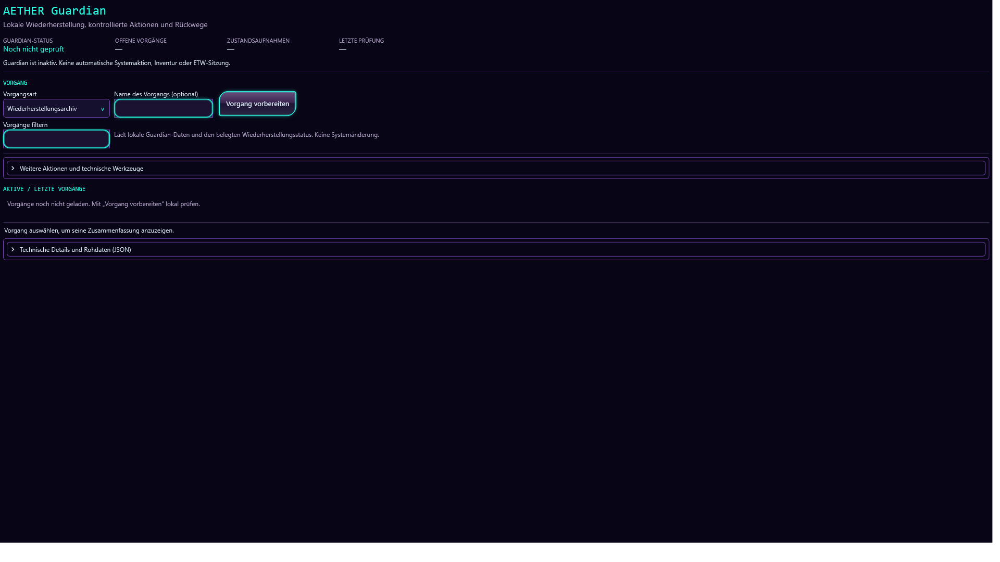

*Guardian mit synthetischen Testdaten zur Demonstration der Oberfläche.
Guardian befindet sich weiterhin in Entwicklung.*

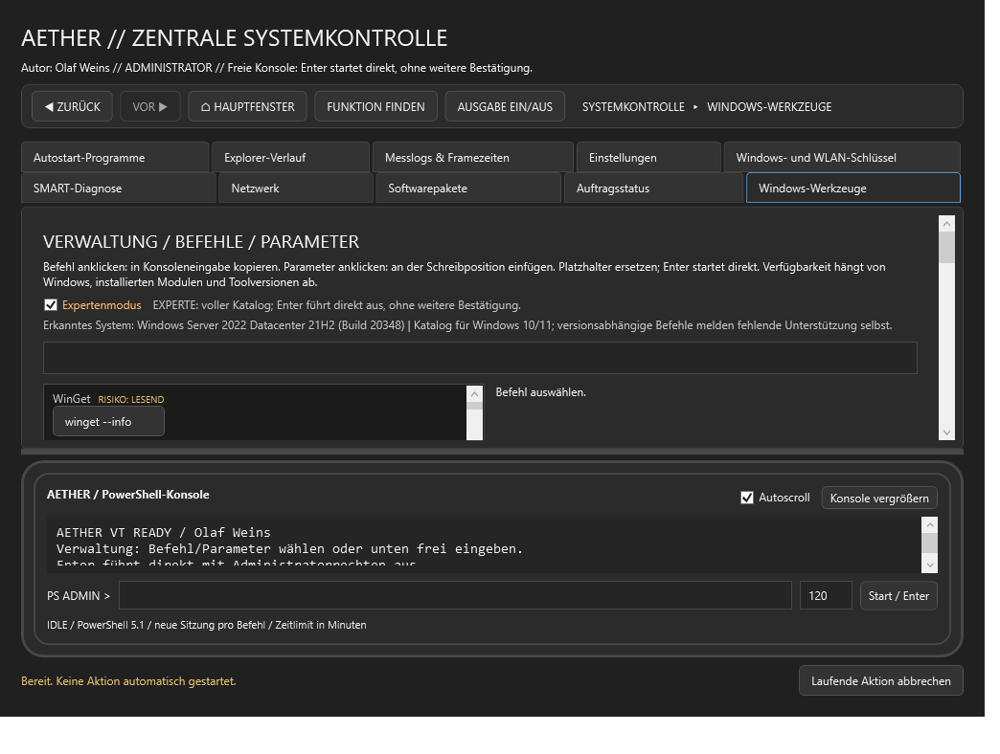

*Zentrale Systemverwaltung und geführte Berechtigungsansicht. Aufnahme
aus dem reproduzierbaren UI-Test.*

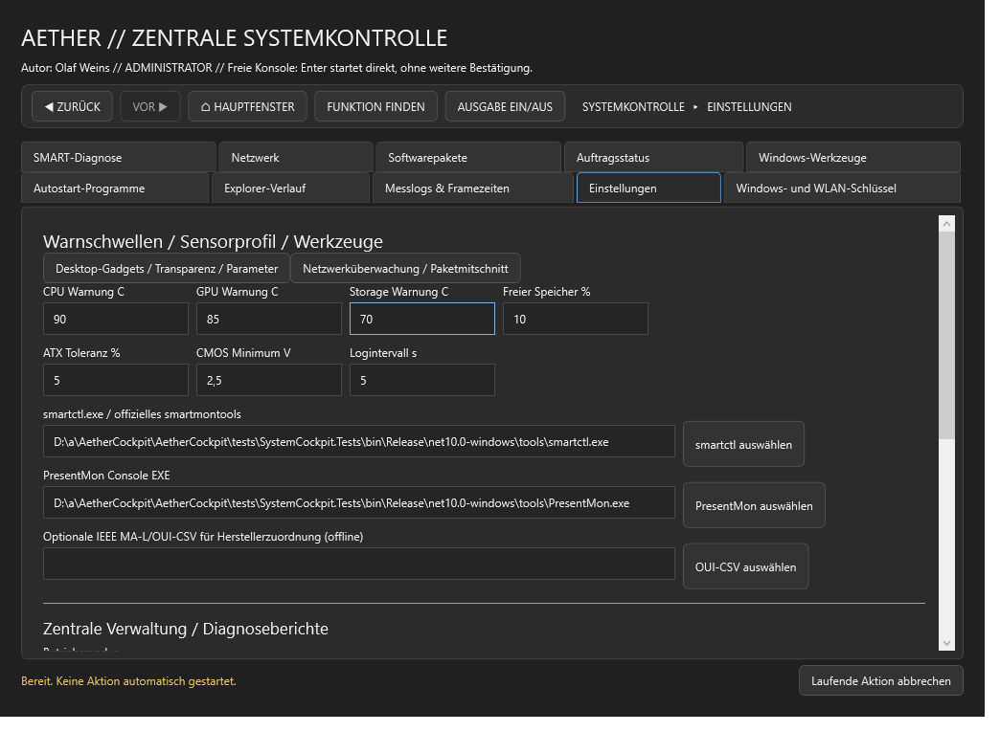

*Warn-, Sensor- und Diagnoseeinstellungen. Aufnahme aus dem
reproduzierbaren UI-Test.*

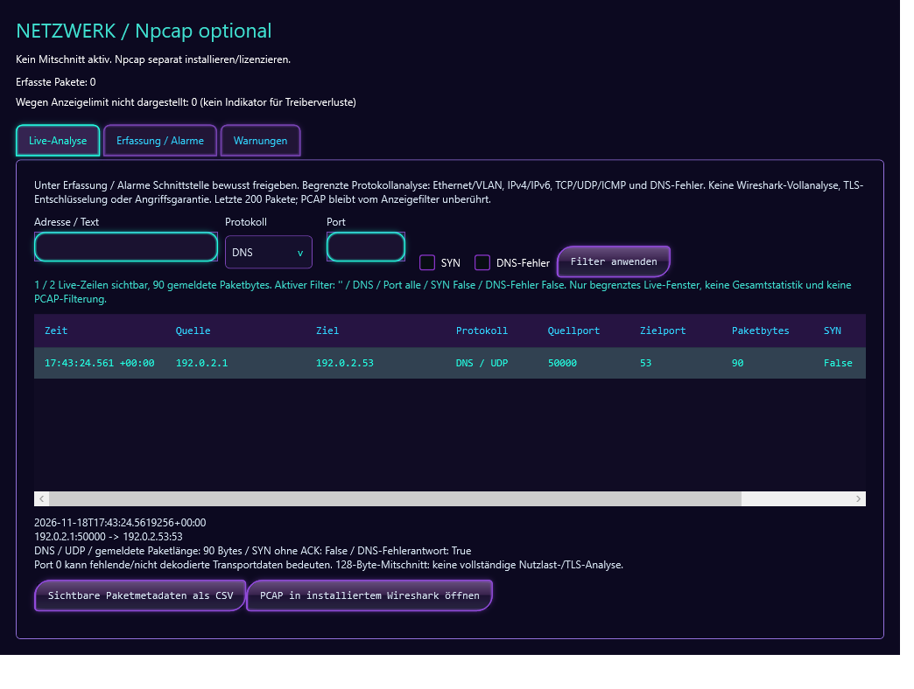

*Netzwerk- und Mitschnittansicht mit synthetischen Daten und sichtbaren
Bestätigungsschranken.*

## Zwei Darstellungsarten

Retro-Neon bleibt die sichtbare AETHER-Signatur. Daneben gibt es eine
zurückhaltendere Windows-Modern-Darstellung.

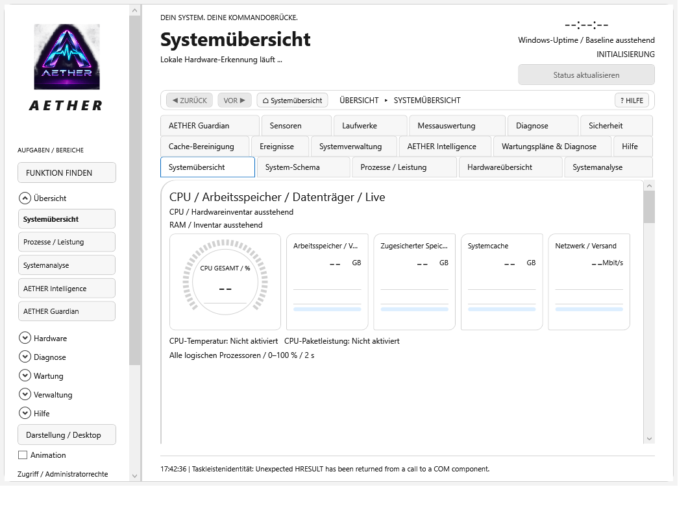

*Windows Modern hell mit denselben Aufgabenbereichen und verständlicher
Statusdarstellung.*

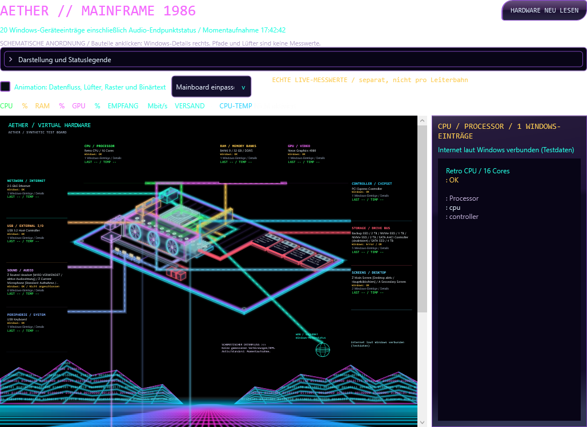

*AETHER-Mainboard in der Retro-Neon-Nachtdarstellung. Die Werte sind
synthetische Testdaten.*

## Lokale Assistenz

AETHER besitzt auch eine lokale Assistenzfunktion.

Windows und die Hardware liefern die eigentlichen Daten. Phi 4 Mini hilft
dabei, diese Daten verständlich zusammenzufassen und technische
Zusammenhänge zu erklären. AETHER prüft die Aussagen anschließend wieder
anhand der vorhandenen Systemdaten.

**AETHER misst. Das Modell hilft beim Einordnen.**

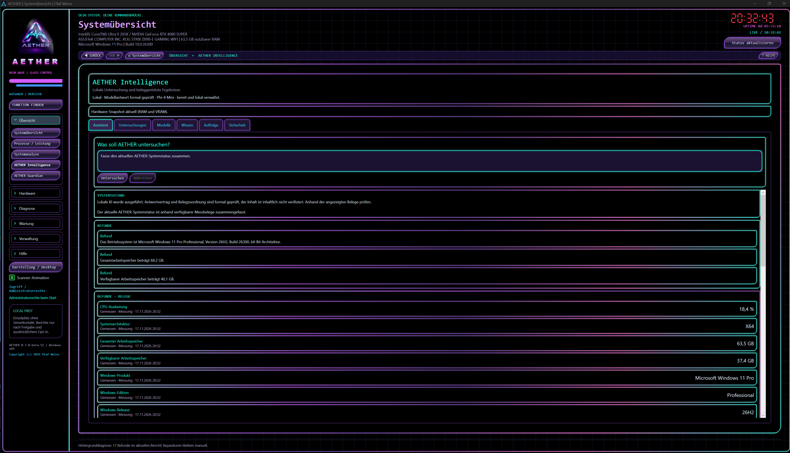

*AETHER Intelligence mit lokalem Modellstatus, technischem Kontext und
Systeminformationen.*

*Technische Belege, geprüfte Aussagen und Validierungsbereich von AETHER
Intelligence.*

### Phi und Nemotron

Phi 4 Mini ist für Beta 54 der geprüfte lokale Modellpfad. Nemotron wurde
untersucht, aber nicht für den automatischen Beta-54-Pfad freigegeben.

## AETHER Local AI Setup

AETHER bringt einen eigenen Einrichtungsassistenten für die lokale
Assistenz mit. Er prüft:

- Hardware
- vorhandene Ollama-Umgebung
- AETHER-Modellspeicher
- Phi 4 Mini
- erforderliche Dateien

Eine vorhandene Benutzer-Ollama-Installation bleibt unangetastet. AETHER
verwendet für seinen eigenen Modellbetrieb einen getrennten Zustand.

*AETHER Local AI Setup für den qualifizierten Phi-4-Mini-Pfad.*

Die Programmpakete enthalten keine Modelldateien. Die normale AETHER-Nutzung
lädt weder Ollama noch Phi 4 Mini im Hintergrund herunter.

## Eigener Installationsauftritt

Der Hauptinstaller und der Uninstaller verwenden das AETHER-Neon-Design
und deutsche Standardseiten.

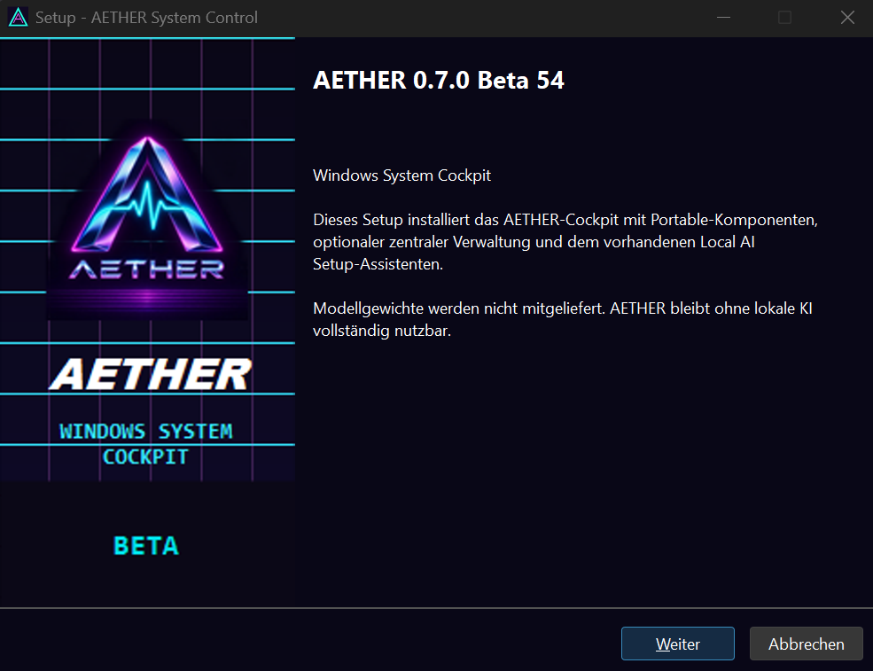

*Willkommensseite des Beta-54-Installers.*

## Optionaler AETHER Server

AETHER Server ist die optionale Erweiterung für mehrere Rechner. Der
einzelne Client funktioniert vollständig ohne Server.

Der Server ist für eine Geräteübersicht, zentrale Zustände und vorhandene
Verwaltungsfunktionen gedacht. In Beta 54 führt er keine serverseitige
Modellinferenz aus.

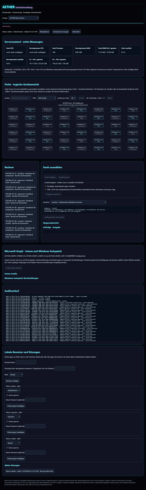

*AETHER Server mit synthetischen Testgeräten zur Demonstration der
zentralen Verwaltung.*

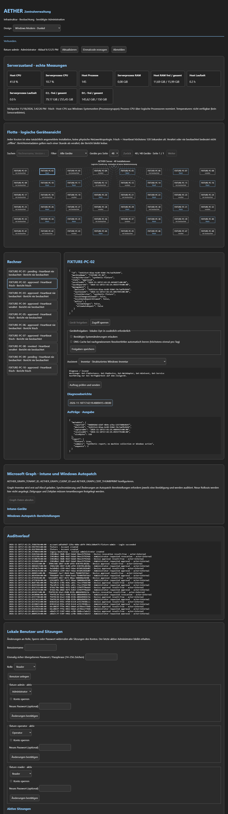

*AETHER Server mit synthetischen Testgeräten zur Darstellung von
Gerätedetails und zugehörigen Zuständen.*

## Wohin AETHER gehen soll

Langfristig möchte ich, dass AETHER immer weniger einzelne Informationen
zeigt und immer besser verständlich macht, wie diese Informationen
zusammenhängen.

Ein Windows-Ereignis allein sagt oft wenig. Ein Prozess, eine Temperatur
oder ein Treiberzustand ebenfalls. Interessant wird es, wenn sichtbar wird:

- was gleichzeitig passiert ist
- was sich vorher verändert hat
- was vom normalen Zustand abweicht
- was wahrscheinlich zusammenhängt

Genau darin soll AETHER weiter wachsen. Ziele sind bessere zeitliche
Zusammenhänge, Hardware- und Softwarehistorie, Baselines, relevante
Abweichungen, nachvollziehbare Ursachenketten, kontrollierte
Reparaturabläufe und die bessere Verwaltung mehrerer Systeme.

Neue lokale Modelle kommen nur dann hinzu, wenn sie zuverlässig genug für
einen klaren Produktpfad sind. Funktionen, die nur Ziel sind, werden nicht
als bereits fertig dargestellt.

AETHER soll den Rechner nicht ungefragt übernehmen. Es soll beobachten,
zusammenführen, erklären und Möglichkeiten anbieten. Ändern darf es erst
nach einer bewussten Entscheidung.

Wenn AETHER sein Ziel erreicht, soll bei einem Problem nicht mehr die erste
Frage sein: „Welches Windows-Werkzeug brauche ich dafür?“

Der erste Weg soll ins AETHER Cockpit führen, um beantworten zu können:

- Was passiert?
- Seit wann?
- Was hat sich verändert?
- Was hängt wahrscheinlich zusammen?
- Was ist tatsächlich belegt?
- Welche Möglichkeiten habe ich?

**Genau dafür baue ich AETHER.**

## AETHER 0.7.0 Beta 54

Beta 54 ist der aktuelle öffentliche AETHER-Stand. Er friert den real
bestandenen Installations-, Local-AI- und Deinstallationsweg ein und
ergänzt ihn um den aktuellen visuellen GitHub-Auftritt.

Die Builds sind unsigniert. Hardware- und Sensorabdeckung hängen vom
jeweiligen Gerät, Treiber und Windows-System ab.

## Download

### Setup

[AETHER-0.7.0-beta.54-Setup-win-x64.exe](https://github.com/oa7779/AetherCockpit/releases/download/v0.7.0-beta.54/AETHER-0.7.0-beta.54-Setup-win-x64.exe)

### Portable

[AETHER-0.7.0-beta.54-Portable-win-x64.zip](https://github.com/oa7779/AetherCockpit/releases/download/v0.7.0-beta.54/AETHER-0.7.0-beta.54-Portable-win-x64.zip)

Das Archiv vollständig in einen eigenen Ordner entpacken. DLLs, Runtime
und Begleitdateien bleiben zusammen.

### Server

[AETHER-0.7.0-beta.54-Server-win-x64.zip](https://github.com/oa7779/AetherCockpit/releases/download/v0.7.0-beta.54/AETHER-0.7.0-beta.54-Server-win-x64.zip)

Der Server ist für den Betrieb eines einzelnen PCs nicht erforderlich.

- [Beta-54-Release](https://github.com/oa7779/AetherCockpit/releases/tag/v0.7.0-beta.54)
- [SHA256SUMS.txt](https://github.com/oa7779/AetherCockpit/releases/download/v0.7.0-beta.54/SHA256SUMS.txt)

Vor dem Start Herkunft und SHA-256-Prüfsumme kontrollieren. Schutzfunktionen
wegen einer Warnung nicht deaktivieren.

## Weitere Dokumentation

- [Funktionsübersicht](docs/FEATURES.md)
- [Installation](docs/INSTALLATION.md)
- [Benutzerhandbuch](docs/USER-GUIDE.md)
- [Hardware und Sensoren](docs/HARDWARE-SENSORS.md)
- [AETHER Intelligence](docs/INTELLIGENCE-ARCHITECTURE.md)
- [Lokale Modellinstallation](docs/INTELLIGENCE-MODEL-INSTALLATION.md)
- [Systemverwaltung](docs/USER-GUIDE.md#verwaltung)
- [Netzwerk und Mitschnitt](docs/NETWORK.md)
- [Zentrale Verwaltung](docs/CENTRAL-MANAGEMENT.md)
- [Sicherheit und Datenschutz](docs/SECURITY-AND-PRIVACY.md)
- [Versionsgeschichte](CHANGELOG.md)

## Lizenz

Lizenz- und Drittanbieterhinweise stehen in [LICENSE](LICENSE) und
[THIRD-PARTY-NOTICES](THIRD-PARTY-NOTICES.md).
