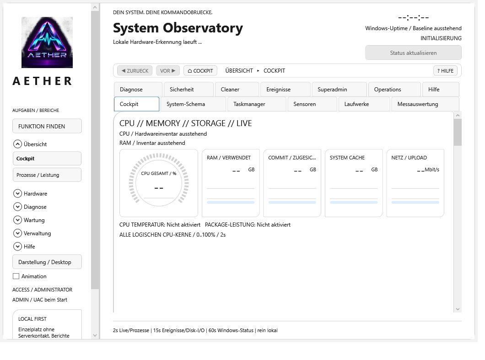
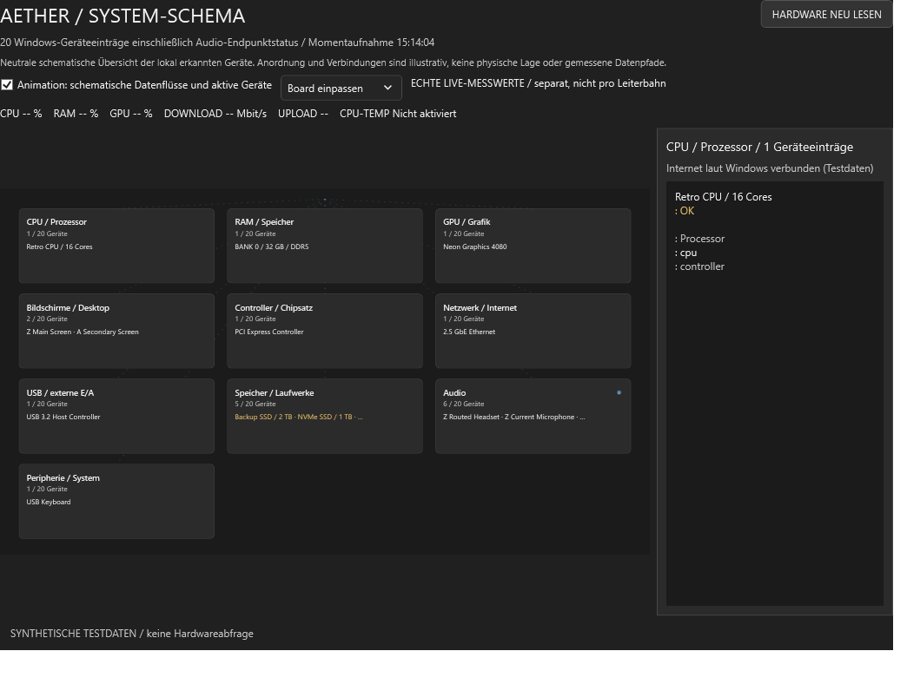
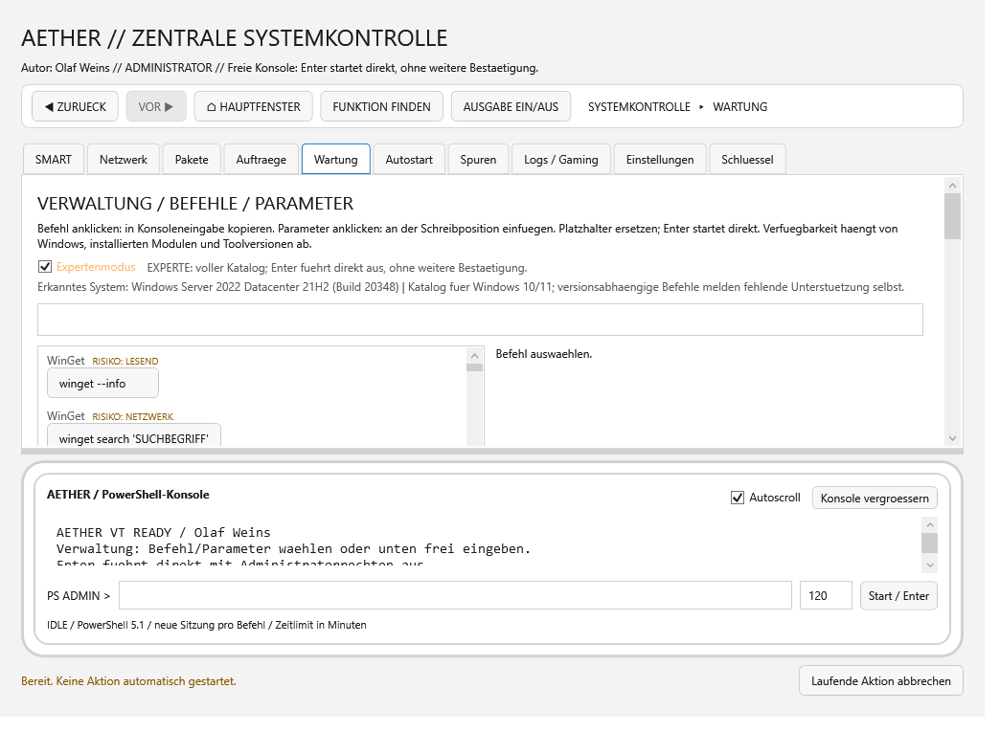
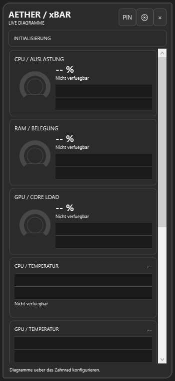
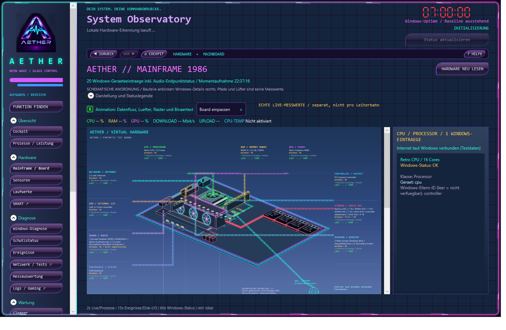
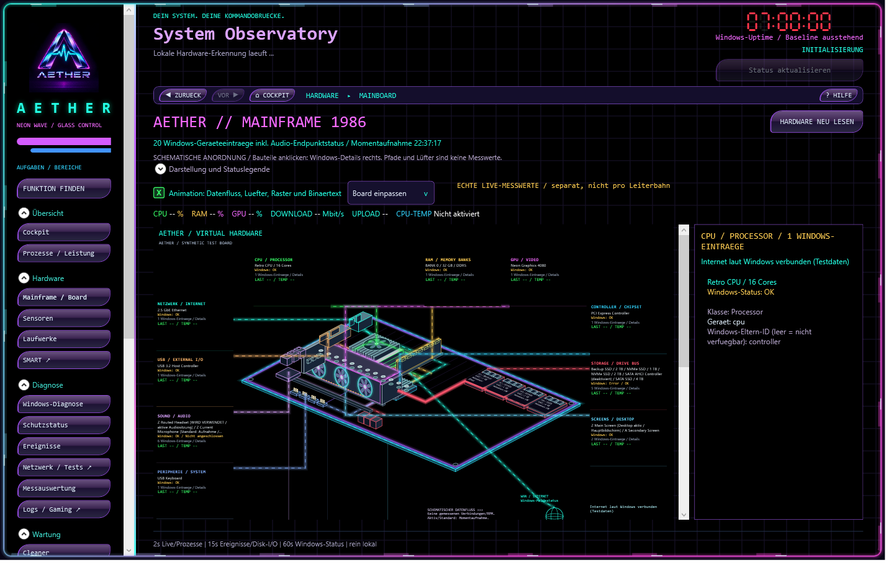
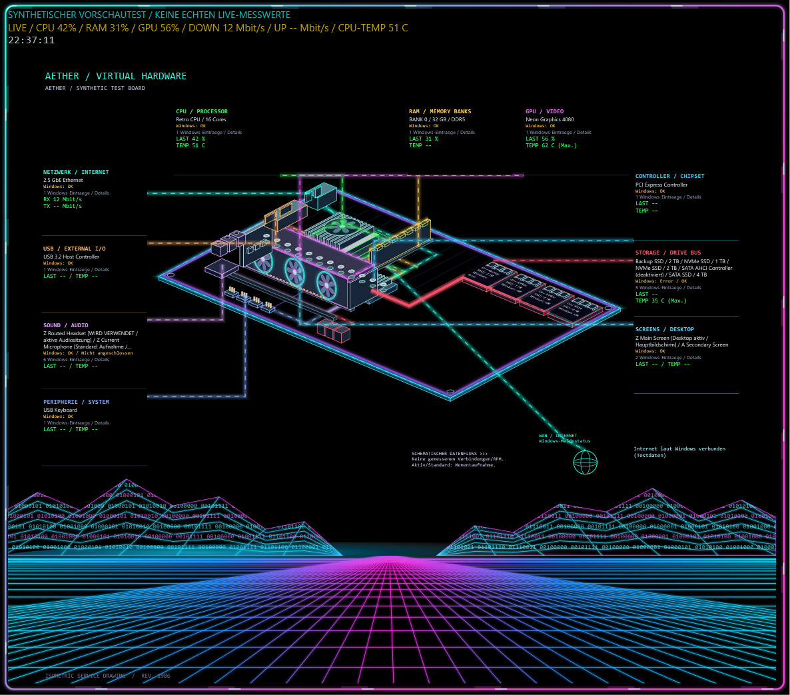

# AETHER / Retro Neon System Control

AETHER ist eine native Windows-Kommandozentrale für Hardwareüberwachung,
Diagnose, Wartung und Systemverwaltung im eigenständigen Retro-Neon-Design.

[Impressum](docs/IMPRESSUM.md) ·
[Datenschutz für Projekt und Support](docs/SECURITY-AND-PRIVACY.md#datenschutz-für-projekt-und-support)

Live-Instrumente, Verlaufskurven und das virtuelle Mainboard zeigen den
Rechnerzustand. Windows-Assistenten helfen, Befunde einzuordnen und passende
Reparaturen vorzubereiten. Gadgets und die xBar halten Messwerte auf dem Desktop.

## Aktueller Beta-Stand

**Unveröffentlichter Arbeitsstand:** Eine eigene Hardwarezentrale mit
Komponentenansichten, Quelleninspektor und datenschutzbewusstem Bericht ist
implementiert. Native Wi-Fi, Direct3D-Funktionen, Audio-/Displaydetails,
zugeordnete SMART-/NVMe-Berichte und echte Sensorstatistik ergänzen die Ansicht.
Gerätegenaue Providerbeziehungen, Windows-Prozessortakte, WDDM-/Videodetails,
TRIM-/Controllerangaben, EDID/HDR und Audioformatprüfungen sind ergänzt.
M3 ist mit dokumentierten technischen Grenzen zur Abnahme empfohlen,
noch nicht vom Auftraggeber abgenommen;
[Prüfbericht und Grenzen](docs/MILESTONE-3-HARDWARE-REPORT.md).
Dieser Arbeitsstand ist nicht im folgenden Beta-Installer enthalten.

**Aktuelle Beta: 0.7.0-beta.45**

Ruhige Neonrahmen mit scharfer Kernkontur, getrenntem Glow und langsamer,
abschaltbarer Atmung ersetzen die umlaufenden Panel-Laufspuren.
Windows Modern bleibt neutral. Technische Quellen-/Ergebnisverträge,
Fehlerprotokollierung und Ressourcenfreigabe sind konsolidiert.
Das ursprüngliche Cockpit zeigt alle bisherigen Anzeigen direkt
auf der Seite, ohne vorgeschaltete Übersicht oder zusätzliche Detailklappe.
Datenträger bündeln Lesen, Schreiben, Aktivität und Queue in einer roten
Karte mit vier farbigen Messreihen und getrennt beschrifteten Skalen.
Kurven und Mainboard behalten ihren kräftigen Glow.
Das Logo im Retro-Neon-Cockpit und Bildschirmschoner ist mit Neon-Puls,
Lichtreflex und Chromschriftzug gestaltet. Enthält bestätigtes Wake-on-LAN und den erweiterten
Windows-Wartungs- und Deploymentkatalog. Microsoft Graph bleibt Teil des
separaten Verwaltungsservers. [Versionsgeschichte](CHANGELOG.md).

**Prüfstatus:** Lokale Releasebuilds, Konsolenassertions und synthetische
Desktopansichten sind geprüft. Rahmenvergleich und offene Produktmessungen:
[Performance-Baseline](docs/PERFORMANCE-BASELINE.md#meilenstein-2-neonrahmenvergleich).
Hardwarebetrieb, Installation und Intune-Verteilung sind
nicht durch diese Tests abgedeckt. Die Pakete sind weiterhin unsigniert.

**Windows Modern** ist als neutrale Desktopoberfläche wählbar.
Hell und dunkel folgen Windows; das animierte **System-Schema** ersetzt dort
das Mainframe. In diesem Design ist der AETHER-Bildschirmschoner deaktiviert.
Retro-Neon und Deutsch bleiben Standard; Englisch ist noch nicht auswählbar.
Der Designwechsel wird nach der Installation mit einem App-Neustart übernommen.

Retro-Neon verwendet schwarze Nacht- und blaue Tag-Hintergründe in Hauptfenster,
Mainframe und Bildschirmschoner. Neonfarben und Glow bleiben erhalten.
Die Funktionen sind nach Aufgaben geordnet, Mainframe-Zeichnung
und Gerätedetails getrennt. GPU-Lüfter sitzen auf der sichtbaren Kühlerseite;
Board und Komponenten erhalten stärkeren Glow. Der Tag-/Nachtmodus folgt
der lokalen Uhrzeit oder einer manuellen Wahl. Die Uhr aktualisiert ihre
Sekunden unabhängig von Hardwareabfragen. Konsolenassistenten ergänzen Windows-Diagnose
und kontrollierte Reparaturen. Die separate Zentralverwaltung bietet eine
HTTPS-Weboberfläche, Geräteüberwachung und feste Remote-Aufträge. Optional
bindet der Server Intune- und Autopatch-Daten über Microsoft Graph ein;
Synchronisierungen und Änderungen an bestehenden Bereitstellungen werden
einzeln bestätigt.
Der Bildschirmschoner bleibt vollständig ohne Musikfunktion.

[Beta-45-Installer und SHA256-Prüfsumme](https://github.com/oa7779/AetherCockpit/releases/tag/v0.7.0-beta.45)
· [Zuletzt laufzeitgeprüfte Beta 36](https://github.com/oa7779/AetherCockpit/releases/tag/v0.7.0-beta.36)
· [Versionsgeschichte](CHANGELOG.md)

**Codesignierung:** Die kostenlose SignPath-Codesignierung ist beantragt;
die Entscheidung steht aus. Die aktuellen Pakete sind weiterhin unsigniert.
[Status und Signaturhinweise](docs/SECURITY-AND-PRIVACY.md#codesignierung).

## Wesentliche Funktionen

- **Beobachten:** CPU-Kerne, Prozesse, RAM, Datenträger, Netzwerk und verfügbare
  Hardware-Sensoren mit Live-Kurven und einstellbaren Warnschwellen.
- **Auswerten:** Sensor-Momentaufnahmen, lokale Messaufzeichnung, Statistik,
  Logvergleich, SMART-Berichte und PresentMon-Framezeiten.
- **Diagnostizieren:** Windows-Status, Ereignisse, Geräte und Treiber sowie
  getrennte Assistenten für Systemdateien, Updates, Wiederherstellung und Verbindungen.
- **Verwalten:** Prozesse, Dienste, Aufgaben, Autostart, Windows-Features,
  Softwarepakete, Deployment-Inventar und ausgewählte Systemeinstellungen.
- **Warten:** vorbereitete Wartungspläne, Dateivorschau in der Cache-Bereinigung,
  Wiederherstellungspunkt und Einzelbestätigung vor Änderungen.
- **Netzwerk:** bestätigtes Wake-on-LAN für MAC-Adressen im lokalen Netz.
- **Auf dem Desktop nutzen:** Retro-Neon-Oberfläche, Skins, Gadgets, xBar,
  Tray und optionaler Multi-Monitor-Bildschirmschoner.

Die [Funktionsübersicht](docs/FEATURES.md) beschreibt den vollständigen Umfang.

## Gestaltung

Glasrahmen, LED-Ziffern und abschaltbare Animation prägen die Oberfläche.
Das anklickbare Mainboard ist schematisch: Leiterbahnen und Lüfter illustrieren
die Szene, echte Messwerte stehen daneben.
Windows Modern verwendet neutrale Karten, Segoe UI und dezente Animation
ohne Neon-Effekte. [Design wechseln](docs/USER-GUIDE.md#windows-modern).

### Windows Modern in Beta 38

Aufnahmen aus dem Windows-CI-Smoke-Test mit synthetischen Daten, ohne
Hardwareinitialisierung. Das Original-Logo bleibt Bestandteil beider Designs.

### Retro-Neon: Schwarz-/Blau-Ansichten

Die Aufnahmen stammen aus dem bestandenen UI-Test der Schwarz-/Blau-Korrektur
vor dem Beta-37-Versionsbuild. Mainframe und Schoner verwenden synthetische
Testdaten. Sie sind kein Laufzeitnachweis für die neuen Pakete.

**Mainframe im Tagmodus mit getrennten Gerätedetails**

**Mainframe im Nachtmodus mit korrigierten GPU-Lüftern**

**Bildschirmschoner mit Neon-Platine und eigener Sekundenanzeige**

## Installation

**Setup:** Die x64-Setup-EXE aus dem Release herunterladen, Prüfsumme vergleichen
und starten. Sie installiert standardmäßig nach
`C:\Program Files\AETHER System Control`. Desktop-Verknüpfung,
Anmeldestart und Bildschirmschoner sind wählbar.

**Portable:** Das ZIP vollständig entpacken und `SystemCockpit.exe` starten.
Alle Dateien und Unterordner zusammen behalten. Die .NET-Laufzeit ist enthalten;
eine einzelne EXE reicht nicht.

Updates, Deinstallation und Verteilungsparameter stehen in der
[Installationsanleitung](docs/INSTALLATION.md).

## Rechte und Daten

Das Cockpit startet mit Windows-UAC und kann für Sensorzugriff einen lokalen
Low-Level-Treiber laden. Daten liegen unter `%LOCALAPPDATA%\AetherCockpit`
des ausführenden Kontos.

Geführte Änderungen verlangen eine Freigabe. **Die freie Administratorkonsole
führt eingegebene Befehle dagegen mit Enter direkt aus.** Vor Reparaturen
wichtige Daten sichern. Die Deinstallation entfernt auch die AETHER-Daten des
ausführenden Kontos.

## Einzelplatz und Clientmodus

Im Standardmodus **Einzelplatz** nimmt AETHER keinen Kontakt zum Verwaltungsserver
auf. Der optionale **Server-Clientmodus** überträgt Diagnoseberichte erst nach
Anmeldung, manueller Gerätefreigabe und gesondertem Übertragungs-Opt-in.
Der Server ist ein separates Quellprojekt, nicht Teil des Cockpit-Setups.

Ein optionaler, gesondert freigegebener Windows-Clientdienst überwacht auch
bei geschlossenem Cockpit. Die Webverwaltung zeigt Berichte und Aufträge;
Systemänderungen brauchen lokale und zentrale Freigaben. Ein opt-in-gesteuerter
DNS-Assistent kann bei passendem Befund den DNS-Cache leeren.
Details: [Zentrale Verwaltung](docs/CENTRAL-MANAGEMENT.md).

## Grenzen der Beta

- Sensorumfang und Windows-Abfragen hängen von Hardware, Treibern, Edition
  und Sicherheitskonfiguration ab. Nicht verfügbare Werte bleiben gekennzeichnet;
  Temperaturgrenzen sind keine Messwerte.
- Das Diagnoseinventar prüft nicht die Funktionsfähigkeit jeder Anwendung.
  Hintergrunddiagnose ist standardmäßig aus. Automatische Reparatur ist auf
  den freigegebenen DNS-Cache-Assistenten begrenzt; Updates und Treiberinstallation
  werden nicht unbeaufsichtigt ausgeführt.
- Windows-Recovery, Cloud-Download und Deployment folgen den jeweiligen
  Windows-/ADK-Funktionen und benötigen passende Editionen, Quellen und Rechte.
  Eine direkte Microsoft-Graph-/Intune-Autopatch-Anbindung ist noch nicht integriert.
- Mitschnitte brauchen separat installiertes Npcap. Die begrenzte Paketansicht
  entschlüsselt kein TLS und liefert keinen umfassenden Angriffsschutz.
- Die x64-Beta ist nicht signiert. SmartScreen kann warnen. Windows 11 mit
  grafischem Desktop ist die Zielumgebung; eine allgemeine Freigabe jeder
  Hardware- und Windows-Build-Kombination liegt nicht vor.

## Drittanbieter

LibreHardwareMonitor, smartmontools und PresentMon behalten ihre eigenen
[Lizenzen und Herkunftshinweise](THIRD-PARTY-NOTICES.md).
Npcap wird separat installiert; das Setup kann seine offizielle Downloadseite öffnen.
Optionale Microsoft-Werkzeuge werden nur bei vorhandener Installation geöffnet;
Downloads und Lizenzannahme bleiben beim Administrator.

## Dokumentation

| Thema | Anleitung |
|---|---|
| Start, Update und Entfernung | [Installation](docs/INSTALLATION.md) |
| Oberfläche und Arbeitsabläufe | [Benutzerhandbuch](docs/USER-GUIDE.md) |
| Produktumfang | [Funktionen](docs/FEATURES.md) |
| Sensoren, SMART und Messdaten | [Hardware und Sensoren](docs/HARDWARE-SENSORS.md) |
| Windows-Verwaltung und Wartung | [System Control](docs/SYSTEM-CONTROL.md) |
| Verbindungen und Mitschnitte | [Netzwerk](docs/NETWORK.md) |
| Rechte und Datenverarbeitung | [Sicherheit und Datenschutz](docs/SECURITY-AND-PRIVACY.md) |
| Server und Client | [Zentrale Verwaltung](docs/CENTRAL-MANAGEMENT.md) |
| Softwareverteilung | [Intune-Deployment](docs/INTUNE-DEPLOYMENT.md) |
| Quellcode und Paketierung | [Entwicklung](docs/DEVELOPMENT.md) |
| Prüfläufe | [Tests](docs/TESTING.md) |
| Rückmeldungen zur Beta | [Betatester-Anleitung](BETA-TESTANLEITUNG.md) |

## Lizenz und Autor

Entwickelt von **Olaf Weins**. Copyright © 2026 Olaf Weins.
AETHER-eigener Quellcode und Dokumentation stehen unter der [MIT-Lizenz](LICENSE).
Drittanbieter behalten ihre eigenen Rechte und Lizenzbedingungen.
