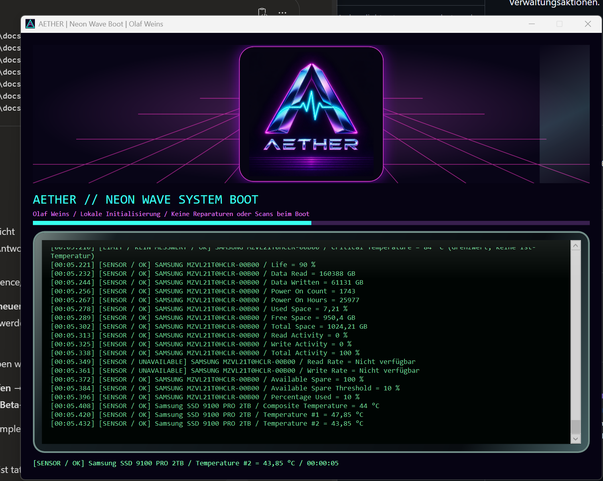
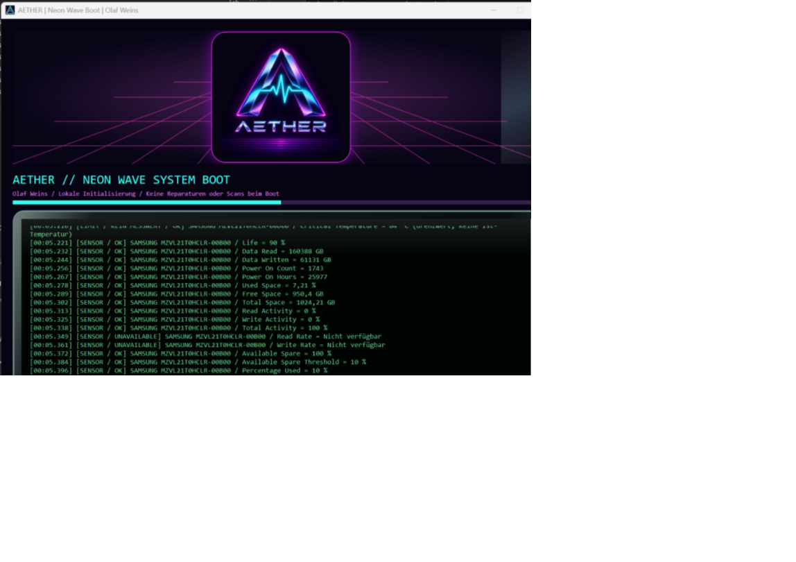
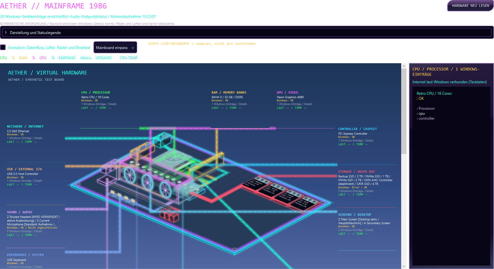
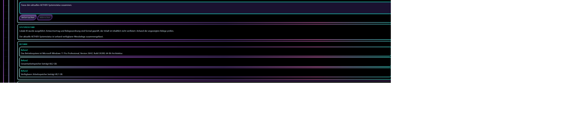
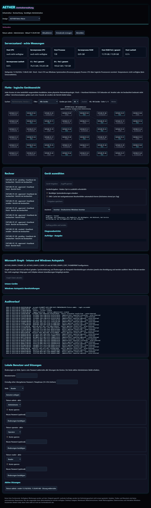
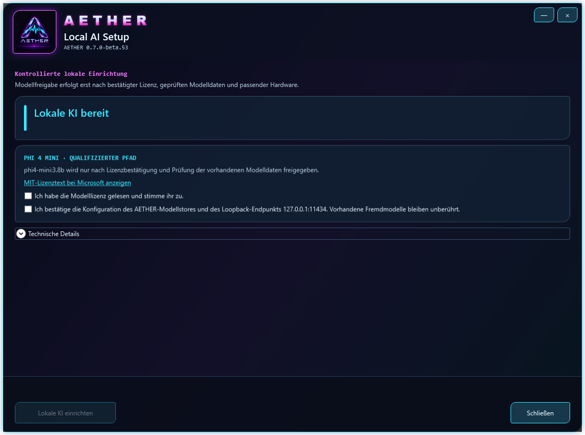

# AETHER

**Eine Windows-Kommandozentrale für den eigenen Rechner.**

Windows bringt für fast jedes technische Thema ein eigenes Werkzeug mit:
Task-Manager, Geräte-Manager, Ereignisanzeige, Dienste, Aufgabenplanung,
Systeminformationen, PowerShell, Netzwerkdiagnose, Hardware-Monitoring
und Programme des jeweiligen Hardwareherstellers.

Die Informationen gehören technisch oft zusammen, liegen aber in mehreren
Anwendungen und Oberflächen verteilt. AETHER soll sie in einem gemeinsamen
Ausgangspunkt zusammenführen. Es ersetzt nicht jedes vorhandene
Windows-Werkzeug und macht aus unbekannten Messwerten keine sicheren
Aussagen.

*Die Systemübersicht von AETHER 0.7.0 Beta 53.*

## Die Idee hinter AETHER

Bei einem Problem mit meinem Rechner möchte ich nicht zuerst überlegen
müssen, welches Windows-Werkzeug oder welches Herstellerprogramm ich jetzt
öffnen sollte. Ich möchte einen gemeinsamen Ausgangspunkt haben:

**Beobachten → Zusammenhänge erkennen → Ursache finden → Maßnahme auswählen
→ kontrolliert handeln**

AETHER soll nicht nur Messwerte anzeigen. Es soll helfen zu sehen, welche
Informationen zusammengehören, was tatsächlich gemessen wurde und wo eine
weitere Prüfung sinnvoll ist.

Der wichtige Grundsatz lautet:

**Erst messen, dann bewerten.**

AETHER unterscheidet soweit technisch möglich zwischen gemessenen Daten,
Informationen von Windows oder Hardware, daraus abgeleiteten
Zusammenhängen, sprachlicher Einordnung und tatsächlich ausgeführten
Änderungen.

*AETHER beim lokalen Systemstart im Retro-Neon-Modus.*

## Was AETHER heute kann

### Systemübersicht

Die Systemübersicht zeigt verfügbare Livewerte und Verläufe zu CPU,
Arbeitsspeicher, GPU, Datenträgern und Netzwerk. Dazu kommen ein
Windows-Status und ausgewählte Hardware-Sensoren. Nicht verfügbare Daten
bleiben als nicht verfügbar gekennzeichnet.

### Hardware

Hardwareansichten ordnen Informationen zu CPU, GPU, Arbeitsspeicher,
Mainboard, Datenträgern, Geräten und verfügbaren Sensoren. Dazu gehören
soweit vorhanden SMART- und NVMe-Befunde. Nicht jede Hardware liefert
dieselben Daten; Temperaturgrenzen und andere Herstellergrenzen sind keine
Messwerte.

### Prozesse und Leistung

AETHER zeigt Prozesse mit Leistungsinformationen und begrenzter Historie.
Ziel ist nicht nur zu sehen, dass Last entsteht, sondern die auffällige
Situation mit Windows-Diensten, Aufgaben, Verbindungen und
Hardwareinformationen einzuordnen. Eine Prozess-I/O-Zahl ist dabei kein
Beweis für physische Datenträgeraktivität.

### Windows-Diagnose

Vorhandene Diagnosebereiche befassen sich unter anderem mit Ereignissen,
Geräten, Treibern, Diensten, Aufgaben, Autostart, Netzwerk, Systemzustand
und ausgewählten Windows-Komponenten. Ereignisse und Inventardaten sind
Hinweise, aber keine vollständige Ursachendiagnose für sich.

*Mainboard- und Hardwareansicht im AETHER Cockpit. Demonstration mit
synthetischen Testdaten.*

### Verwaltung und Wartung

AETHER bietet geführte Abläufe für ausgewählte Prozesse, Dienste, Aufgaben,
Netzwerkeinstellungen und Windows-Funktionen. Vor einer unterstützten
Änderung werden Ziel und erwartete Wirkung angezeigt; anschließend ist
eine bewusste Bestätigung erforderlich.

Analyse und Änderung bleiben getrennt. AETHER führt aufgrund einer
Diagnose nicht ungefragt Änderungen am System aus. Nicht jede Aktion kann
zurückgenommen werden; Windows-Rechte und Richtlinien gelten weiter.

## AETHER Intelligence

AETHER besitzt eine lokale Assistenzfunktion. Der interessante Teil ist
nicht, dass ein Sprachmodell eingebaut wurde. Der wichtige Punkt ist:

**AETHER soll dem Modell nicht blind glauben.**

Der Ablauf ist dafür bewusst getrennt:

1. AETHER liest reale Windows- und Hardwareinformationen.
2. Relevante Daten werden als technische Belege aufbereitet.
3. Das lokale Modell erhält nur den für die Aufgabe benötigten Kontext.
4. Das Modell formuliert eine strukturierte Antwort.
5. AETHER prüft technische Aussagen gegen die vorhandenen Daten.
6. Nicht belegbare oder widersprüchliche Aussagen werden nicht einfach als
   Tatsache angezeigt.

*AETHER Intelligence mit Modellstatus, technischen Daten und
Validierungsbereich.*

*Technischer Detailbereich von AETHER Intelligence mit Findings,
Modellstatus und Prüfinformationen.*

Der qualifizierte Modellpfad in Beta 53 ist **Phi 4 Mini**
(`phi4-mini:3.8b`). Die Verarbeitung erfolgt lokal über Ollama. AETHER
prüft dabei Claims, kanonische Werte und Belegreferenzen; eine solche
Prüfung ist keine allgemeine semantische Wahrheitsgarantie.

AETHER selbst funktioniert auch ohne eingerichtetes Sprachmodell. Die
normale Nutzung lädt weder die Ollama-Runtime noch Modellgewichte herunter.

### Warum lokale KI?

Ein Windows-PC liefert viele technische Informationen. Ein erfahrener
Benutzer kann diese selbst zusammensetzen, muss dafür aber häufig mehrere
Quellen durchsuchen. Das lokale Modell soll dabei helfen, vorhandene
Informationen verständlich zusammenzufassen und einzuordnen.

**Das Sprachmodell ist Helfer und Dolmetscher, nicht die Messstelle.**

### Phi und Nemotron in Beta 53

**Phi 4 Mini** ist der qualifizierte Standardpfad und tatsächlich für den
lokalen automatischen Einsatz freigegeben.

**Nemotron 3 Nano 4B** ist nicht Bestandteil des freigegebenen
Beta-53-Modellpfads und im Setup nicht auswählbar. Die Variante wurde
technisch untersucht, hat aber die vollständige Produktqualifikation nicht
bestanden. **Nemotron 3 Nano 30B** bleibt ein möglicher Kandidat für eine
spätere Hardware- und Infrastrukturprüfung.

AETHER nimmt Modelle erst in den Produktpfad auf, wenn Identität, Lizenz,
Digest, Hardwarebedarf, Ausgabe und bestehende Validierungsverträge
zusammenpassen.

## Local first und Client first

AETHER ist zuerst ein Programm für den lokalen Windows-PC. Ein einzelner
Rechner bleibt ohne Server vollständig benutzbar. Der lokale Client hat
Vorrang.

Der separate Server ergänzt AETHER für zentrale Verwaltungs- und
Managementszenarien mit mehreren Rechnern. Er ist keine Voraussetzung für
den Einzelplatzbetrieb. In Beta 53 führt der Server keine lokale oder
serverseitige Modellinferenz aus.

Langfristig kann der Server zusätzliche Aufgaben übernehmen, aber nur dort,
wo dies technisch und wirtschaftlich sinnvoll ist. Eine kostenpflichtige
Cloud-Infrastruktur ist keine Voraussetzung und wird nicht automatisch
eingerichtet.

*AETHER Server mit synthetischen Testgeräten zur Demonstration der zentralen
Verwaltungsansicht.*

## Warum AETHER so aussieht

Ich wollte kein weiteres graues Verwaltungsprogramm bauen.

### Retro-Neon

AETHER verwendet dunkle Flächen, Cyan, Magenta und Grün für positive
Zustände sowie technische Instrumente mit Mainboard- und Cockpit-Anmutung.
Liveanzeigen und Verläufe sollen helfen, den aktuellen Zustand schneller zu
erfassen. Farben zeigen Bereiche und Zustände; sie ersetzen weder Messwerte
noch Quellen.

### Windows Modern

Daneben gibt es eine zurückhaltendere Windows-Modern-Darstellung für
Anwender, die lieber neutrale Fenster und Diagramme verwenden. Animationen
lassen sich abschalten.

*Guardian-Arbeitsbereich der AETHER-Oberfläche. Darstellung mit synthetischen
Testdaten; Guardian bleibt in Entwicklung.*

## AETHER Local AI Setup

Der Hauptinstaller enthält den separaten Assistenten **AETHER Local AI
Setup**. Er gehört optisch zur AETHER-Produktfamilie, verwendet das
Neon-Design mit Logo und Wortmarke und besitzt einen definierten,
verschiebbaren Header.

Der Assistent prüft System, Hardware und vorhandene Runtime, zeigt die
Modelllizenz und benötigt eine ausdrückliche Annahme. Er richtet den
unterstützten Phi-4-Mini-Pfad kontrolliert ein und startet keinen
Modellbezug ungefragt. Vorhandene qualifizierte lokale Daten können
wiederverwendet werden.

Modellgewichte und Ollama-Runtime sind nicht Teil der GitHub-Programmpakete.

*AETHER Local AI Setup für den qualifizierten lokalen Phi-4-Mini-Pfad.*

## AETHER 0.7.0 Beta 53

Beta 53 ist die aktuelle Vorabversion. Ihr Schwerpunkt liegt auf dem
zusammenhängenden Local-AI-Setup, dem qualifizierten Phi-4-Mini-Pfad, der
Prüfung von Modellantworten gegen vorhandene Systemdaten sowie dem
vollständigen Windows-Installer.

Bereitgestellt werden:

- die vollständige Portable-Version,
- das Windows-Setup mit integriertem AETHER Local AI Setup,
- die separate Serverversion für optionale Managementszenarien,
- ein konsistentes AETHER-Branding.

Hardware- und Sensorabdeckung hängen vom jeweiligen Gerät, Treiber und
Windows-System ab. Die Builds sind unsigniert.

## Download

### Setup

Für die normale Installation:

[AETHER-0.7.0-beta.53-Setup-win-x64.exe](https://github.com/oa7779/AetherCockpit/releases/download/v0.7.0-beta.53/AETHER-0.7.0-beta.53-Setup-win-x64.exe)

Das Setup enthält den Assistenten **AETHER Local AI Setup**.

### Portable

Zum direkten Entpacken und Starten:

[AETHER-0.7.0-beta.53-Portable-win-x64.zip](https://github.com/oa7779/AetherCockpit/releases/download/v0.7.0-beta.53/AETHER-0.7.0-beta.53-Portable-win-x64.zip)

Das Archiv vollständig in einen eigenen Ordner entpacken. DLLs, Runtime
und Begleitdateien bleiben zusammen.

### Server

Nur für zentrale Verwaltungsfunktionen:

[AETHER-0.7.0-beta.53-Server-win-x64.zip](https://github.com/oa7779/AetherCockpit/releases/download/v0.7.0-beta.53/AETHER-0.7.0-beta.53-Server-win-x64.zip)

Der Server ist für den Betrieb eines einzelnen PCs nicht erforderlich.

Prüfsummen und weitere Dateien:

- [Beta-53-Release](https://github.com/oa7779/AetherCockpit/releases/tag/v0.7.0-beta.53)
- [SHA256SUMS.txt](https://github.com/oa7779/AetherCockpit/releases/download/v0.7.0-beta.53/SHA256SUMS.txt)

Keine der Veröffentlichungsdateien enthält Modellgewichte. Vor dem Start
Herkunft und SHA-256-Prüfsumme kontrollieren. Schutzfunktionen wegen einer
Warnung nicht deaktivieren.

## Wohin AETHER gehen soll

Langfristig soll AETHER Windows-Diagnose, Hardwarezustand, Prozesse,
Ereignisse und zeitliche Zusammenhänge noch stärker zusammenführen:

- Baselines und Abweichungen vom normalen Rechnerzustand,
- belegbare Zusammenhänge und Ursachenketten,
- kontrollierte Reparatur und Wartung,
- Hardware- und Softwarehistorie,
- zentrale Verwaltung mehrerer Systeme,
- lokale Modelle für unterschiedliche Aufgaben und Hardwareklassen.

Das Ziel ist nicht:

**„Eine KI steuert selbständig den Rechner.“**

Sondern:

**AETHER versteht immer besser, was auf dem Rechner passiert, und gibt dem
Benutzer die Informationen und Werkzeuge, um selbst kontrolliert zu
entscheiden.**

Bei einem Rechnerproblem soll ich nicht mehr zuerst überlegen müssen:

**„Welches Windows-Werkzeug brauche ich dafür jetzt wieder?“**

AETHER soll als Ausgangspunkt helfen zu beantworten:

- Was passiert?
- Seit wann?
- Was hängt damit zusammen?
- Was ist wahrscheinlich die Ursache?
- Was ist tatsächlich belegt?
- Welche Möglichkeiten bestehen?
- Was soll anschließend geändert werden?

Genau dafür wird AETHER gebaut.

## Weitere Dokumentation

- [Funktionsübersicht](docs/FEATURES.md)
- [Installation](docs/INSTALLATION.md)
- [Benutzerhandbuch](docs/USER-GUIDE.md)
- [Hardware und Sensoren](docs/HARDWARE-SENSORS.md)
- [AETHER Intelligence](docs/INTELLIGENCE-ARCHITECTURE.md)
- [Lokale Modellinstallation](docs/INTELLIGENCE-MODEL-INSTALLATION.md)
- [Systemverwaltung](docs/USER-GUIDE.md#verwaltung)
- [Netzwerk und Mitschnitt](docs/NETWORK.md)
- [Zentrale Verwaltung](docs/CENTRAL-MANAGEMENT.md)
- [Sicherheit und Datenschutz](docs/SECURITY-AND-PRIVACY.md)
- [Versionsgeschichte](CHANGELOG.md)

## Lizenz

AETHER-eigener Quellcode und diese Dokumentation stehen unter der
[MIT-Lizenz](LICENSE). Drittanbieter behalten ihre eigenen Rechte und
Lizenzbedingungen.
