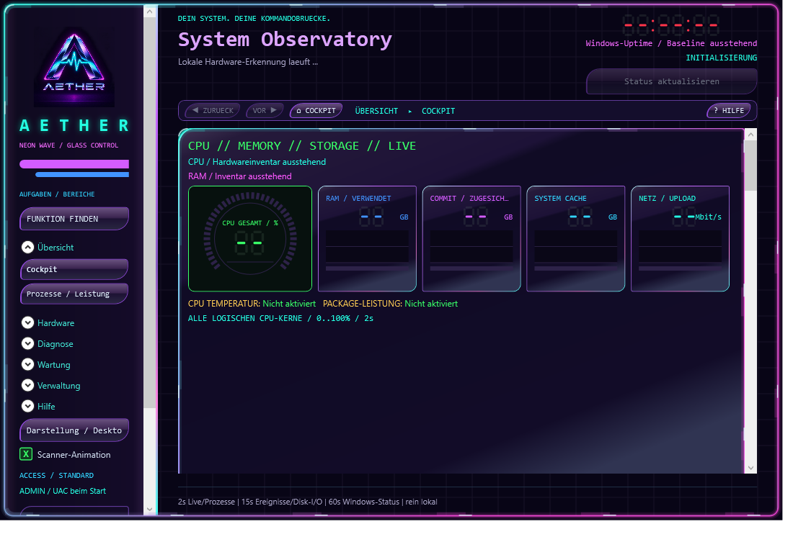
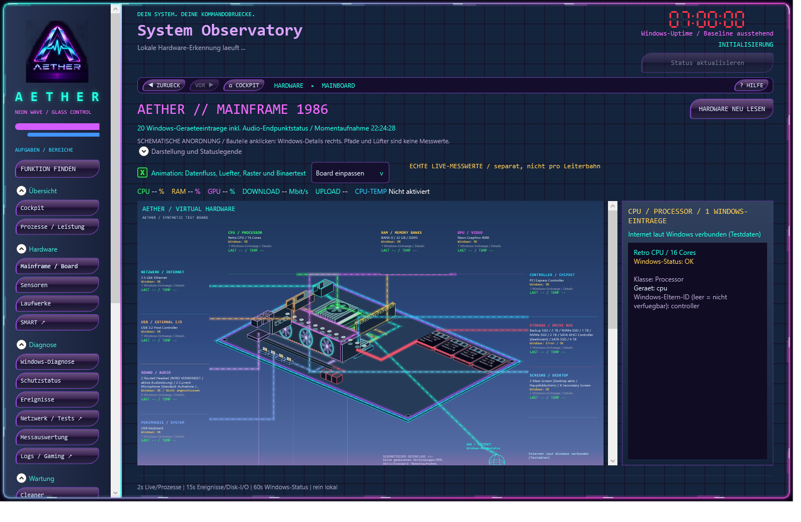
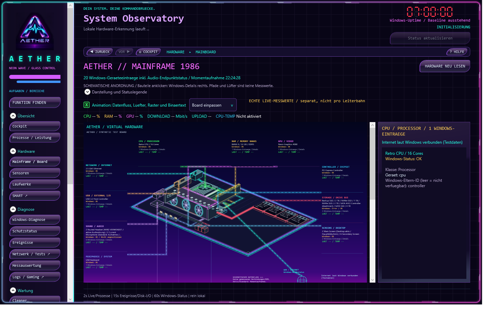
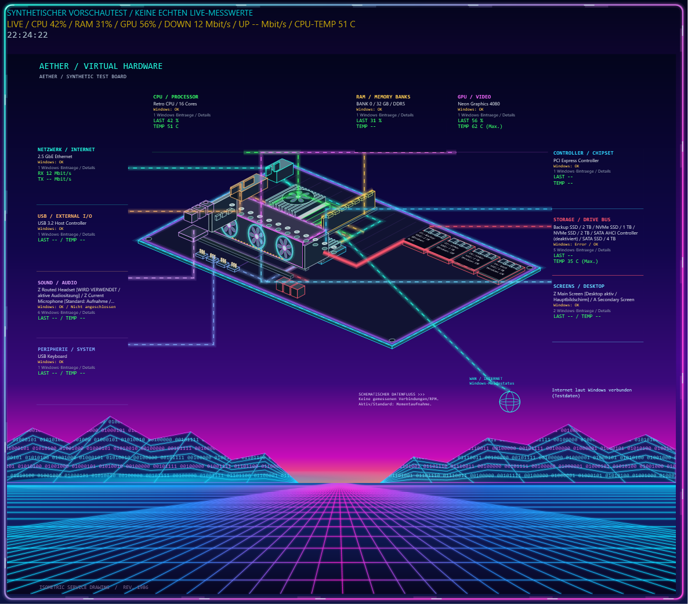

# AETHER / Retro Neon System Control

AETHER ist eine native Windows-Kommandozentrale für Hardwareüberwachung,
Diagnose, Wartung und Systemverwaltung im eigenständigen Retro-Neon-Design.

Live-Instrumente, Verlaufskurven und das virtuelle Mainboard zeigen den
Rechnerzustand. Windows-Assistenten helfen, Befunde einzuordnen und passende
Reparaturen vorzubereiten. Gadgets und die xBar halten Messwerte auf dem Desktop.

## Aktueller Beta-Stand

**Aktuelle Beta: 0.7.0-beta.36**

Beta 36 ordnet die Funktionen nach Aufgaben und trennt Mainframe-Zeichnung
und Gerätedetails. GPU-Lüfter sitzen auf der sichtbaren Kühlerseite;
Board und Komponenten erhalten stärkeren Glow. Der Tag-/Nachtmodus folgt
der lokalen Uhrzeit oder einer manuellen Wahl. Die Uhr aktualisiert ihre
Sekunden unabhängig von Hardwareabfragen. Konsolenassistenten ergänzen Windows-Diagnose
und kontrollierte Reparaturen. Die separate Zentralverwaltung bietet eine
HTTPS-Weboberfläche, Geräteüberwachung und feste Remote-Aufträge.
Der Bildschirmschoner bleibt vollständig ohne Musikfunktion.

[Aktuelle Downloads und SHA256-Prüfsummen](https://github.com/oa7779/AetherCockpit/releases/latest)
· [Versionsgeschichte](CHANGELOG.md)

## Wesentliche Funktionen

- **Beobachten:** CPU-Kerne, Prozesse, RAM, Datenträger, Netzwerk und verfügbare
  Hardware-Sensoren mit Live-Kurven und einstellbaren Warnschwellen.
- **Auswerten:** Sensor-Momentaufnahmen, lokale Messaufzeichnung, Statistik,
  Logvergleich, SMART-Berichte und PresentMon-Framezeiten.
- **Diagnostizieren:** Windows-Status, Ereignisse, Geräte und Treiber sowie
  getrennte Assistenten für Systemdateien, Updates und Verbindungen.
- **Verwalten:** Prozesse, Dienste, Aufgaben, Autostart, Windows-Features,
  Softwarepakete und ausgewählte Systemeinstellungen.
- **Warten:** vorbereitete Wartungspläne, Dateivorschau im Cleaner,
  Wiederherstellungspunkt und Einzelbestätigung vor Änderungen.
- **Auf dem Desktop nutzen:** Retro-Neon-Oberfläche, Skins, Gadgets, xBar,
  Tray und optionaler Multi-Monitor-Bildschirmschoner.

Die [Funktionsübersicht](docs/FEATURES.md) beschreibt den vollständigen Umfang.

## Gestaltung

Glasrahmen, LED-Ziffern und abschaltbare Animation prägen die Oberfläche.
Das anklickbare Mainboard ist schematisch: Leiterbahnen und Lüfter illustrieren
die Szene, echte Messwerte stehen daneben.

### Einblicke in Beta 36

Die Aufnahmen zeigen die Anwendung im lokalen UI-Test: Das Dashboard wartet
auf Messwerte, Mainframe und Schoner verwenden synthetische Testdaten.
Die Bilder werden auf GitHub bereitgestellt.

**Dashboard und aufgabenbezogene Navigation**

**Mainframe im Tagmodus mit getrennten Gerätedetails**

**Mainframe im Nachtmodus mit korrigierten GPU-Lüftern**

**Bildschirmschoner mit Neon-Platine und eigener Sekundenanzeige**

## Installation

**Setup:** Die x64-Setup-EXE aus dem Release herunterladen, Prüfsumme vergleichen
und starten. Sie installiert standardmäßig nach
`C:\Program Files\AETHER System Control`. Desktop-Verknüpfung,
Anmeldestart und Bildschirmschoner sind wählbar.

**Portable:** Das ZIP vollständig entpacken und `SystemCockpit.exe` starten.
Alle Dateien und Unterordner zusammen behalten. Die .NET-Laufzeit ist enthalten;
eine einzelne EXE reicht nicht.

Updates, Deinstallation und Verteilungsparameter stehen in der
[Installationsanleitung](docs/INSTALLATION.md).

## Rechte und Daten

Das Cockpit startet mit Windows-UAC und kann für Sensorzugriff einen lokalen
Low-Level-Treiber laden. Daten liegen unter `%LOCALAPPDATA%\AetherCockpit`
des ausführenden Kontos.

Geführte Änderungen verlangen eine Freigabe. **Die freie Administratorkonsole
führt eingegebene Befehle dagegen mit Enter direkt aus.** Vor Reparaturen
wichtige Daten sichern. Die Deinstallation entfernt auch die AETHER-Daten des
ausführenden Kontos.

## Einzelplatz und Clientmodus

Im Standardmodus **Einzelplatz** nimmt AETHER keinen Kontakt zum Verwaltungsserver
auf. Der optionale **Server-Clientmodus** überträgt Diagnoseberichte erst nach
Anmeldung, manueller Gerätefreigabe und gesondertem Übertragungs-Opt-in.
Der Server ist ein separates Quellprojekt, nicht Teil des Cockpit-Setups.

Ein optionaler, gesondert freigegebener Windows-Clientdienst überwacht auch
bei geschlossenem Cockpit. Die Webverwaltung zeigt Berichte und Aufträge;
Systemänderungen brauchen lokale und zentrale Freigaben. Ein opt-in-gesteuerter
DNS-Assistent kann bei passendem Befund den DNS-Cache leeren.
Details: [Zentrale Verwaltung](docs/CENTRAL-MANAGEMENT.md).

## Grenzen der Beta

- Sensorumfang und Windows-Abfragen hängen von Hardware, Treibern, Edition
  und Sicherheitskonfiguration ab. Nicht verfügbare Werte bleiben gekennzeichnet;
  Temperaturgrenzen sind keine Messwerte.
- Das Diagnoseinventar prüft nicht die Funktionsfähigkeit jeder Anwendung.
  Hintergrunddiagnose ist standardmäßig aus. Automatische Reparatur ist auf
  den freigegebenen DNS-Cache-Assistenten begrenzt; Updates und Treiberinstallation
  werden nicht unbeaufsichtigt ausgeführt.
- Mitschnitte brauchen separat installiertes Npcap. Die begrenzte Paketansicht
  entschlüsselt kein TLS und liefert keinen umfassenden Angriffsschutz.
- Die x64-Beta ist nicht signiert. SmartScreen kann warnen. Windows 11 mit
  grafischem Desktop ist die Zielumgebung; eine allgemeine Freigabe jeder
  Hardware- und Windows-Build-Kombination liegt nicht vor.

## Drittanbieter

LibreHardwareMonitor, smartmontools und PresentMon behalten ihre eigenen
[Lizenzen und Herkunftshinweise](THIRD-PARTY-NOTICES.md).
Npcap wird separat installiert; das Setup kann seine offizielle Downloadseite öffnen.
Optionale Microsoft-Werkzeuge werden nur bei vorhandener Installation geöffnet;
Downloads und Lizenzannahme bleiben beim Administrator.

## Dokumentation

| Thema | Anleitung |
|---|---|
| Start, Update und Entfernung | [Installation](docs/INSTALLATION.md) |
| Oberfläche und Arbeitsabläufe | [Benutzerhandbuch](docs/USER-GUIDE.md) |
| Produktumfang | [Funktionen](docs/FEATURES.md) |
| Sensoren, SMART und Messdaten | [Hardware und Sensoren](docs/HARDWARE-SENSORS.md) |
| Windows-Verwaltung und Wartung | [System Control](docs/SYSTEM-CONTROL.md) |
| Verbindungen und Mitschnitte | [Netzwerk](docs/NETWORK.md) |
| Rechte und Datenverarbeitung | [Sicherheit und Datenschutz](docs/SECURITY-AND-PRIVACY.md) |
| Server und Client | [Zentrale Verwaltung](docs/CENTRAL-MANAGEMENT.md) |
| Softwareverteilung | [Intune-Deployment](docs/INTUNE-DEPLOYMENT.md) |
| Quellcode und Paketierung | [Entwicklung](docs/DEVELOPMENT.md) |
| Prüfläufe | [Tests](docs/TESTING.md) |
| Rückmeldungen zur Beta | [Betatester-Anleitung](BETA-TESTANLEITUNG.md) |

## Lizenz und Autor

Entwickelt von **Olaf Weins**. Copyright © 2026 Olaf Weins.
AETHER-eigener Quellcode und Dokumentation stehen unter der [MIT-Lizenz](LICENSE).
Drittanbieter behalten ihre eigenen Rechte und Lizenzbedingungen.
